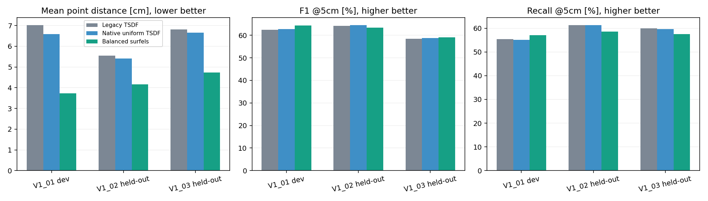

# StereoFuse-VIO

Offline stereo-depth + visual-inertial mapping experiments on EuRoC MAV.
The project combines pretrained IGEV++, OpenVINS v2.7 and two mapping backends:
frustum-bounded TSDF and frame-supported voxel surfels.

The measured balanced preset uses uniform surfel fusion, 3cm voxels, six input
keyframes of support and small-component filtering. It exports a point surface,
not a watertight mesh. Spatial/temporal confidence proxies remain experimental:
their development ablations did not improve F1 and they are disabled in the preset.

## Get the source

```sh
git clone --recurse-submodules <this-repository-url>
```

IGEV++ is pinned as a submodule to upstream commit
`099dec97989780d151700459c682df1cc2c18e88`. Its license and attribution remain in
that submodule. OpenVINS is built from its official v2.7 source by
[`openvins/Dockerfile`](openvins/Dockerfile). No pretrained weights are redistributed.

## Run the balanced mapper

Requirements: NumPy, SciPy and PyYAML; Pillow for preparation; PyTorch/CUDA for
integration; scikit-image for TSDF mesh extraction. A complete environment can
run every phase, or separate CPU/GPU interpreters can be supplied.

The mapper consumes existing EuRoC calibration/images, IGEV++ disparity caches
and raw OpenVINS trajectories at the paths described in
[`pipeline/FUSION_V2.md`](pipeline/FUSION_V2.md). It does not download data/models.

```sh
python pipeline/run_balanced_fusion.py --sequence V1_01_easy
```

Optional: `--cpu-python`, `--gpu-python`, `--work`, and explicit `--rebuild` when
prepared-cache fingerprints change. Balanced outputs are written to
`outputs/<sequence>/stage8_fusion_balanced/`; historical outputs are preserved.

```sh
python -m unittest discover -s pipeline/tests -v
```

## Results and limitations

See the [architecture improvement report](reports/08_fusion_architecture_improvement.md)
for measured accuracy, precision/recall/F1, timings and ablations. The preset was
selected on V1_01 before evaluating V1_02/V1_03. The three sequences share a scene.
Reference registration is evaluation-only; the mapper works in native VIO coordinates.
No calibrated-uncertainty, novel-method, universal-best or end-to-end 20FPS claim is made.



The [audit index](reports/README.md) covers source evidence, calibration, reference
validity, reproducibility and research limitations. Compact metric/configuration
JSONs and figures are included. Datasets, weights, trajectories, large caches,
meshes, logs and generated HTML reports remain local and are ignored by Git.
Artifact-dependent checks require those local inputs; a source clone alone is
not a complete dataset/model distribution.

To generate the comparison page after reproducing the experiment artifacts:

```sh
python reports/scripts/report_fusion_v2.py
```

The page is written to `report/fusion_v2_comparison.html`.
