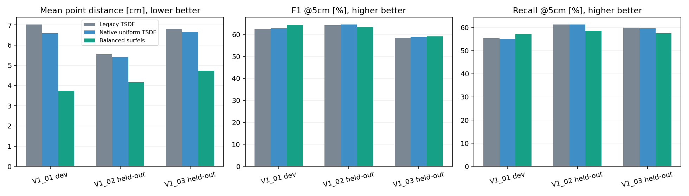

# depth_vio — StereoFuse-VIO

Offline stereo-depth + visual-inertial mapping experiments on EuRoC MAV.
The current pipeline combines pretrained IGEV++, VINS-Fusion and two mapping backends:
frustum-bounded TSDF and frame-supported voxel surfels.

The measured balanced preset uses uniform surfel fusion, 3cm voxels, six input
keyframes of support and small-component filtering. It exports a point surface,
not a watertight mesh. Spatial/temporal confidence proxies remain experimental:
their development ablations did not improve F1 and they are disabled in the preset.

## Latest depth-assisted run

The selected V1_01 configuration uses IGEV++ depth directly in VINS-Fusion with
information weight 4 and depth at 1 Hz, followed by balanced surfel mapping.
See [the latest run](reports/latest_run.md) for measured ATE/RPE, trajectory and 3D point cloud.

```sh
python pipeline/run_tuned_pipeline.py
```

This uses existing disparity inputs and a frozen baseline reference. Outputs go to
`outputs/V1_01_easy/latest/`; an existing completed run is refused. The selected
settings are in `vins_fusion/tuned_config.json`. They were tuned on V1_01 and have
not been independently validated on another sequence. See the latest report for
input prerequisites and depth-image build instructions. Old generated run folders
and HTML reports have been cleaned; reports 01–10 retain historical measurements.

## Get the source

```sh
git clone --recurse-submodules <this-repository-url>
```

IGEV++ is pinned as a submodule to upstream commit
`099dec97989780d151700459c682df1cc2c18e88`. Its license and attribution remain in
that submodule. VINS-Fusion is built from official commit
`be55a937a57436548ddfb1bd324bc1e9a9e828e0` by
[`vins_fusion/Dockerfile`](vins_fusion/Dockerfile). No pretrained weights are redistributed.
Historical OpenVINS code and measurements are retained for comparison; they are
not measurements of VINS-Fusion.

## Run VINS-Fusion

With Docker Desktop running Linux containers and EuRoC ASL data in `data/<sequence>/`:

```sh
python pipeline/run_vins_fusion.py --sequence V1_01_easy --build
```

This builds ROS Melodic/VINS-Fusion, converts ASL images/IMU into a ROS bag,
runs stereo + IMU odometry, and exports native IMU poses to
`outputs/V1_01_easy/stage7_vins_fusion/vins_fusion_traj_tum.txt`.
See [`vins_fusion/README.md`](vins_fusion/README.md) for conventions and scope.

An opt-in extension now feeds cached IGEV++ depth directly into VINS-Fusion's
pose optimizer, with a paired depth-off/depth-on ATE/RPE benchmark. See
[`vins_fusion/DEPTH_INTEGRATION.md`](vins_fusion/DEPTH_INTEGRATION.md).

## Run the balanced mapper

Requirements: NumPy, SciPy and PyYAML; Pillow for preparation; PyTorch/CUDA for
integration; scikit-image for TSDF mesh extraction. A complete environment can
run every phase, or separate CPU/GPU interpreters can be supplied.

The mapper consumes existing EuRoC calibration/images, IGEV++ disparity caches
and raw VINS-Fusion trajectories at the paths described in
[`pipeline/FUSION_V2.md`](pipeline/FUSION_V2.md). It does not download data/models.

```sh
python pipeline/run_balanced_fusion.py --sequence V1_01_easy
```

Optional: `--cpu-python`, `--gpu-python`, `--work`, and explicit `--rebuild` when
prepared-cache fingerprints change. Balanced outputs are written to
`outputs/<sequence>/stage8_fusion_balanced_vins_fusion/`; historical outputs are preserved.
Use `--vio-backend openvins` explicitly to reproduce the old mapper inputs.

```sh
python -m unittest discover -s pipeline/tests -v
```

## Results and limitations

The existing results below were measured with **OpenVINS**, before the VINS-Fusion
integration. They must not be attributed to VINS-Fusion. See the
[architecture improvement report](reports/08_fusion_architecture_improvement.md)
for measured accuracy, precision/recall/F1, timings and ablations. The preset was
selected on V1_01 before evaluating V1_02/V1_03. The three sequences share a scene.
Reference registration is evaluation-only; the mapper works in native VIO coordinates.
No calibrated-uncertainty, novel-method, universal-best or end-to-end 20FPS claim is made.



The [audit index](reports/README.md) covers source evidence, calibration, reference
validity, reproducibility and research limitations. Compact metric/configuration
JSONs and figures are included. The latest trajectory and point cloud are also included.
Datasets, weights, large caches,
meshes, logs and generated HTML reports remain local and are ignored by Git.
Artifact-dependent checks require those local inputs; a source clone alone is
not a complete dataset/model distribution.

To generate the comparison page after reproducing the experiment artifacts:

```sh
python reports/scripts/report_fusion_v2.py
```

The page is written to `report/fusion_v2_comparison.html`.
