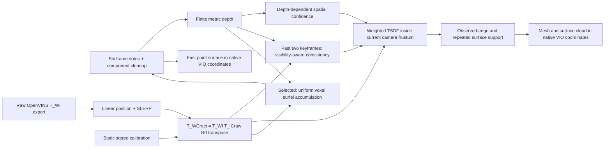

# Fusion v2: balanced depth + VIO mapping

The old `stage8_fusion.py` remains available as a baseline. Development outputs
live under `outputs/<sequence>/stage8_fusion_v2/`; the selected runner writes
`outputs/<sequence>/stage8_fusion_balanced/`. Existing maps, estimator and weights
are unchanged.

**Measured balanced preset:** `surfel_uniform`, 3cm voxels, at least six input
keyframes per voxel, connected components below 30 points removed. This exports
a **surfel point surface**, not a watertight mesh. Confidence proxies are disabled
because development ablations worsened F1. TSDF remains available when a mesh is
required. See the [three-sequence results](../reports/08_fusion_architecture_improvement.md).



Ground truth and Leica are used **only by the separate evaluator**, after mapping.
The mapper does not load an aligned trajectory or a reference-derived world box.
Volume bounds come from measured depth points in native VIO coordinates. This is
an offline two-pass bound calculation; the volume is bounded, not an unbounded
sparse/global map. Do not describe this implementation as a voxel-hashing backend.

## What changes

- Pose lookup interpolates translation and rotation. It refuses extrapolation,
  duplicate timestamps and gaps greater than 151 ms. No time-offset correction is
  invented when the legacy run did not record online camera/IMU calibration.
- Invalid/NaN/Inf disparity never becomes a valid depth measurement.
- Depth confidence uses the stereo sensitivity `sigma_z ~ z² sigma_d/(fx B)`,
  capped weights and lower weights around depth discontinuities. `sigma_d=0.5px`
  is a heuristic proxy, **not a calibrated probabilistic error model**.
- Causal temporal checks use the preceding two actual depth measurements. Missing
  pixels, outside-image points and points hidden behind a past foreground surface
  are neutral. Contradictions away from previous depth edges reduce weight; two
  contradictions without agreement reject a proposed phantom foreground point.
- Previous depths are not averaged into current depth, so a reused/warped sample
  is not counted again as an independent measurement. Pose covariance blocks are
  retained by the loader but are not naively used as camera uncertainty.
- Integration projects only voxels inside the camera frustum's volume AABB,
  processes them in bounded chunks, and does not retain a full XYZ center grid.
- Per-voxel observation counts are separate from confidence weight. Extraction
  requires observed edge endpoints and optionally repeated near-surface support.
  Small disconnected triangle components can be removed.
- A prepared-cache manifest fingerprints source files, raw pose export,
  calibration/configuration and code. Changed settings require a separate work
  directory or an explicit rebuild, rather than silently reusing old predictions.

The frozen choice is recorded in `reports/artifacts/fusion_v2/selection.json` and
`pipeline/fusion_balanced.json`. It was selected before held-out metrics were read.
Standalone `fusion_v2.py` defaults remain useful for diagnostic experiments; use
`run_balanced_fusion.py` to run the selected balanced configuration.

## Run

Run from the repository root, using an interpreter that contains the required
packages. A single environment with all dependencies can run all three phases.
No package or model download is performed automatically.

```powershell
python pipeline/fusion_v2.py prepare --sequence V1_01_easy
python pipeline/fusion_v2.py integrate --sequence V1_01_easy --variant temporal
python pipeline/fusion_v2.py extract --sequence V1_01_easy --variant temporal --min-surface-support 1
```

Dependencies: NumPy, SciPy, PyYAML; preparation additionally Pillow; integration
additionally PyTorch/CUDA; extraction additionally scikit-image. OpenCV and Open3D
are not needed for this mapping path. In the current workstation, use the existing
CPU Python for preparation/extraction and the existing CUDA Python for integration:

```powershell
$cpu = 'C:\Users\Lenovo\Documents\BHYT_Vinmec\.venv\Scripts\python.exe'
$gpu = 'C:\Users\Lenovo\Documents\meddies-health-ai\.venv-4060\Scripts\python.exe'
& $cpu pipeline/run_balanced_fusion.py --sequence V1_01_easy --cpu-python $cpu --gpu-python $gpu
& $gpu -m unittest discover -s pipeline/tests -v
```

`uniform`, `spatial`, and `temporal` variants use identical prepared depths/poses,
volume resolution, bounds and frame timestamps. They isolate the effect of
spatial and temporal weighting. Surface support thresholds can be evaluated
without rerunning integration. Do not select these thresholds on held-out data.

## Coordinate/export contracts

T_AB transforms B points into A. Raw pose input is Hamilton xyzw T_WI, not camera
pose. The exported mesh is in native OpenVINS world coordinates. Frame identifiers,
raw pose hash, rectified calibration and T_I_Crect are in the prepared manifest.
The evaluator applies one frozen SE3 registration to both map and poses only after
integration; it never uses ICP or the VIO-fitted `gtrotcorr` orientation reference.

`integration.json` reports per-frame synchronized integration time and peak CUDA
allocation. Preparation time includes disk reads, color rectification, temporal
checks and serialized cache writes. Neither number includes stereo inference.
These separate offline timings must not be presented as end-to-end online FPS.

## Known limits

- Uses existing IGEV++ predictions; it cannot recover metric accuracy lost by a
  wrong disparity, calibration or systematic pose bias merely by assigning weights.
- A past-frame consistency test can mistake moving objects for contradictions;
  this suppresses some inconsistent surfaces but is not dynamic segmentation.
- Pose/measurement cross-covariance, temporal correlation and online extrinsic/time
  calibration are not available from the legacy input. No covariance-calibrated
  UATDF novelty is claimed.
- Offline depth-derived bounds need a first pass. Large-scale online operation
  should use bounded sparse submaps, not expand this dense array without a limit.
- Existing cache provenance is incomplete: fingerprinting now prevents subsequent
  cache changes, but cannot retroactively prove how the original predictions were
  generated.
- Validation uses the original Leica reference and one scene. It measures the
  reported protocol, not absolute ground-truth correctness or cross-scene generalization.
