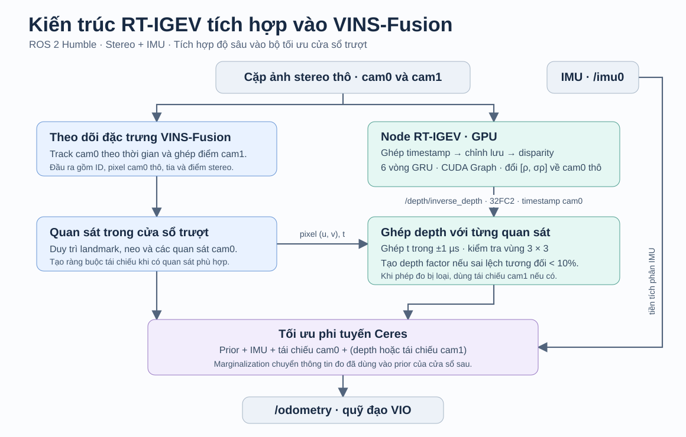

# Tích hợp RT-IGEV vào VINS-Fusion trên ROS 2 Humble



Cặp ảnh stereo cấp dữ liệu cho bộ theo dõi đặc trưng VINS-Fusion và node RT-IGEV. Node GPU xuất nghịch đảo độ sâu theo timestamp và lưới pixel thô của cam0. Backend lấy mẫu tại các điểm đang được theo dõi và đưa phép đo được chấp nhận vào bộ tối ưu Ceres. IMU đi vào VINS-Fusion qua nhánh tiền tích phân.

## Mã nguồn tích hợp

| Tệp | Vai trò |
| --- | --- |
| [`apply_ros2_depth_patch.py`](vins_patch/apply_ros2_depth_patch.py) | **Tệp tích hợp chính.** Thêm subscriber ROS 2, gắn mẫu depth vào quan sát, thêm residual Ceres và đưa residual tương ứng vào marginalization. Patch dành cho bản port VINS-Fusion ROS 2 Humble tại commit `8993f55`. |
| [`depth_node.py`](depth_node/depth_node.py) | Ghép ảnh stereo theo timestamp, giữ cặp mới nhất cho worker GPU và publish ảnh `32FC2`. |
| [`stereo_models.py`](depth_node/stereo_models.py) | Nạp mô hình RT-IGEV với trọng số Scene Flow, chạy mặc định 6 vòng cập nhật GRU bằng mixed precision và CUDA Graph. |
| [`stereo_geometry.py`](depth_node/stereo_geometry.py) | Chỉnh lưu cặp ảnh và đổi disparity thành nghịch đảo độ sâu trên lưới cam0 thô. |
| [`depth_topic_provider.h`](vins_patch/depth_topic_provider.h) | Kiểm tra kích thước và buffer ảnh, ghép theo timestamp, lấy mẫu nghịch đảo độ sâu trong vùng 3 × 3. |
| [`igev_depth_factor.h`](../vins_fusion/depth/igev_depth_factor.h) | Hai depth factor Ceres cho quan sát neo và quan sát ở frame khác, kèm Jacobian giải tích. |
| [`euroc_stereo_imu_depth.yaml`](config/euroc_stereo_imu_depth.yaml) | Topic, ngoại chuẩn camera–IMU và tham số tích hợp. |

## Thuật toán tích hợp

### 1. Tạo phép đo từ cặp ảnh stereo

1. Ghép cam0 và cam1 có cùng timestamp. Nếu worker GPU đang bận, giữ cặp hoàn chỉnh mới nhất đang chờ.
2. Chỉnh lưu ảnh theo hiệu chuẩn. RT-IGEV trích đặc trưng hai ảnh, tạo group-wise correlation volume, tổng hợp thành geometry encoding volume và hồi quy disparity ban đầu. Mỗi vòng GRU lấy mẫu volume quanh disparity hiện tại rồi cập nhật $d \gets d + \Delta d$. Lần cuối đưa kết quả về kích thước ảnh.
3. Với mỗi pixel thô $(u,v)$ của cam0, khử méo để lấy tia $q=[x,y,1]^T$. Chiếu $R_0q$ lên ảnh chỉnh lưu để lấy disparity $d$ bằng nearest-neighbor. Với $s=(R_0q)_z$, tiêu cự chỉnh lưu $f_x$ và baseline $B$, tính

   $$
   Z_{\mathrm{rect}}=\frac{f_x B}{d},\qquad
   \rho_m=\frac{1}{Z_{\mathrm{cam0}}}=\frac{s\,d}{f_x B},\qquad
   \sigma_{\rho,\mathrm{proxy}}=\max\!\left(0.025\,\rho_m,\frac{|s|\,\sigma_d}{f_x B}\right),\quad \sigma_d=1\ \mathrm{px}.
   $$

4. Phát ảnh little-endian `32FC2` lên `/depth/inverse_depth` với hai kênh `[ρ_m, σ_ρ,proxy]` tính bằng m⁻¹ và giữ nguyên header của cam0. Pixel ngoài miền độ sâu mặc định 0,2–4 m hoặc có hình học không hợp lệ được mã hóa thành hai số 0. Sigma là giá trị xấp xỉ theo nhiễu disparity và tỷ lệ nghịch đảo độ sâu.

### 2. Gắn depth vào quan sát VINS-Fusion

1. Chỉ chọn frame backend sau khi bộ ước lượng đã vào chế độ tối ưu phi tuyến **và** đã di chuyển ít nhất **0,5 m** kể từ lúc khởi tạo (`depth_start_dist`), cộng thêm **1 s** (`depth_start_delay`). Điều kiện này tránh đưa depth vào lúc cất cánh. Hai frame dùng ảnh depth cách nhau khoảng **0,2 s** trở lên (`depth_period`, 5 Hz).
2. Tìm ảnh depth có timestamp trong **±1 µs** quanh timestamp của frame cam0. Dung sai này bù làm tròn khi VINS chuyển timestamp sang `double`. Backend chờ tối đa **80 ms** và có thể kết thúc chờ sớm khi thấy ảnh mới hơn. Nếu thiếu ảnh depth, frame tiếp tục chạy với quan sát ảnh và IMU.
3. Lấy mẫu vùng **3 × 3** quanh pixel nguyên gần nhất. Cả chín mẫu ở hai kênh phải hữu hạn và dương. Lấy `ρ_m = mean(ρ)`, giữ mẫu nếu `(max(ρ) − min(ρ)) / ρ_m < 0.08`, và dùng `σ = max(σ_ρ,proxy) / √16` trong factor.
4. Nếu landmark chưa có độ sâu ước lượng, quan sát neo có mẫu hợp lệ và chưa có ghép stereo, cấu hình cho phép khởi tạo độ sâu bằng `1 / ρ_m`.

### 3. Thêm ràng buộc trong cửa sổ trượt

Gọi $i$ là frame neo, $j$ là frame quan sát, $\rho_i$ là nghịch đảo độ sâu của landmark đang được tối ưu và $q_i$ là tia chuẩn hóa cam0 ở frame neo. Dùng $T_{ab}$ cho phép biến đổi tọa độ từ hệ $b$ sang hệ $a$. Với pose IMU $T_{WB_k}$ tại frame $k$ và ngoại chuẩn cam0–IMU $T_{BC_0}$, độ sâu dự đoán ở frame quan sát là

$$
\hat Z_j=\left[
T_{BC_0}^{-1} T_{WB_j}^{-1} T_{WB_i} T_{BC_0}
\left(q_i/\rho_i\right)
\right]_z.
$$

| Quan sát | Residual chuẩn hóa | Điều kiện chấp nhận |
| --- | --- | --- |
| Frame neo $j=i$ | `r = (ρ_i − ρ_m) / σ` | `abs(ρ_i − ρ_m) / ρ_m < 0.10` |
| Frame khác $j≠i$ | `r = (Ẑ_j − Z_m) · ρ_m² / σ`, với `Z_m = 1 / ρ_m` | `abs(Ẑ_j − Z_m) / Z_m < 0.10` |

Mỗi phép đo đã qua ngưỡng được đưa vào Ceres với robust loss hiện có của VINS. Với quan sát đó, depth factor thay residual tái chiếu cam1 vì hai phép đo cùng dùng cặp stereo. Nếu thiếu depth hoặc phép đo bị loại, backend dùng residual cam1 khi có ghép stereo. Các residual cam0 giữa các frame và IMU tiếp tục đi vào bài toán. Khi loại frame cũ nhất, marginalization đưa các depth factor liên quan đã được chấp nhận vào prior của cửa sổ kế tiếp.

### Mã giả

```text
GPU worker:
    left, right = cặp stereo mới nhất có cùng timestamp
    left_rect, right_rect = rectify(left, right, calibration)
    disparity = RT_IGEV(left_rect, right_rect, iters=6)
    rho_map, sigma_map = convert_to_raw_cam0(disparity, calibration)
    publish_32FC2(left.header, rho_map, sigma_map)

VINS backend cho mỗi frame:
    cập nhật tracks và tiền tích phân IMU
    nếu đủ thời gian khởi động và đến kỳ lấy depth:
        depth = tìm ảnh trùng timestamp cam0, chờ tối đa 80 ms
        nếu có depth:
            gắn mẫu 3×3 hợp lệ vào các quan sát cam0 của frame
    tam giác hóa hoặc khởi tạo landmark từ mẫu depth đủ điều kiện
    thêm prior, IMU và residual tái chiếu cam0
    cho từng quan sát đủ điều kiện tham gia tối ưu:
        nếu có mẫu depth và sai lệch tương đối < 0.10:
            thêm depth factor và đánh dấu quan sát dùng depth
        ngược lại, nếu có ghép stereo:
            thêm residual tái chiếu cam1
    tối ưu Ceres, marginalize khi trượt cửa sổ và xuất odometry
```

## Chạy với EuRoC

Trong WSL Ubuntu 22.04, dùng ROS 2 Humble, Ceres 2.1 và môi trường PyTorch CUDA theo [hướng dẫn cài đặt](README.md). Cấu hình yêu cầu ngoại chuẩn cố định, `estimate_td: 0` và `td: 0.0`.

```bash
bash realtime/vins_patch/build_vins_depth.sh
bash scripts/prep_vins_euroc_cfg.sh rt_igev_depth
PY=~/venv_depth/bin/python bash realtime/tools/make_bags.sh
bash realtime/tools/run_vio.sh V1_02_medium rt_igev_depth 1 weight=16 gate=0.1 period=0.2 maxcnt=200 mindist=25 delay=1 dist=0.5
```

Nguồn upstream của mô hình và bộ ước lượng. [IGEV++ và RT-IGEV](https://github.com/gangweiX/IGEV-plusplus) · [Bài báo IGEV++](https://arxiv.org/abs/2409.00638) · [VINS-Fusion ROS 2 Humble](https://github.com/fanhong-li/VINS-Fusion-ROS2-Humble)
