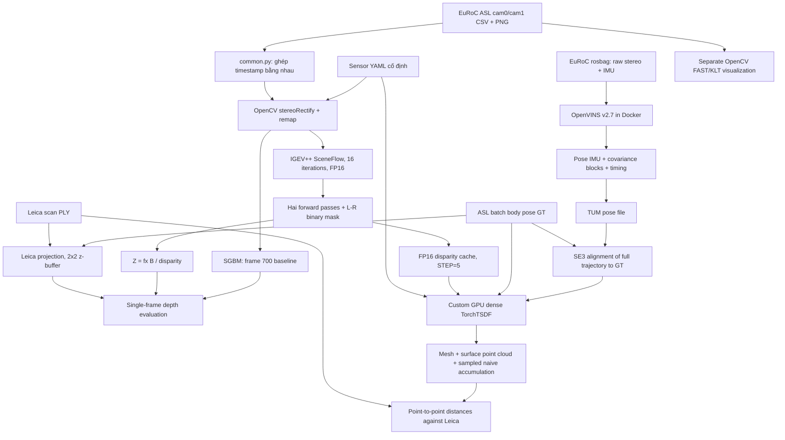

Ngày đánh giá: **2026-11-07 (Asia/Bangkok)**. Phạm vi: snapshot workspace hiện tại.

**VERIFIED** = phép kiểm tra/tính toán được chạy trong đợt audit này, có script và artifact.
**REPORTED** = số được lưu/báo cáo trước đây, chưa chạy lại phép đo tương ứng.
**NOT EVALUATED** = chưa chạy hoặc thiếu điều kiện. Tái tính metric trên prediction lưu sẵn
không đồng nghĩa đã chạy lại inference hay xác thực tuyệt đối ground truth.

Nguồn số liệu audit: [audit_results.json](artifacts/audit_results.json),
[input_manifest.json](artifacts/input_manifest.json), [audit_run.log](artifacts/audit_run.log).
Mã production, estimator, weights và dữ liệu gốc được giữ nguyên; mọi file mới ở `reports/`.

# 01 — Source code và kiến trúc thực tế

## Kết luận

StereoFuse-VIO là **prototype tích hợp offline có đầu ra thực**, gồm pretrained stereo,
VIO độc lập và TSDF. Chưa có bằng chứng về model mới, fine-tuning, uncertainty-aware fusion,
hay tightly coupled depth–inertial estimator. Không thể xác nhận toàn hệ thống đã đúng/chính xác
chỉ từ hình render. Những phần hình học cốt lõi có tính nhất quán nội bộ, nhưng evaluation
còn hạn chế về reference orientation, fairness, registration và vùng quan sát.

## Cấu trúc đã kiểm tra

| Thư mục | Nội dung/thực trạng |
| --- | --- |
| `IGEV-plusplus/` | Source chính thức, `core/`, `core_rt/`, scripts train/eval; không thấy bằng chứng train cục bộ |
| `IGEV-plusplus/pretrained_models/` | IGEV++ SceneFlow/KITTI/Middlebury/ETH3D và RT SceneFlow/KITTI |
| `openvins/` | Dockerfile, launch, build log; source C++ nằm trong Docker image, không nằm ở host |
| `data/{sequence}/mav0/` | Ảnh ASL, IMU, Vicon, batch pose GT, calibration và Leica PLY |
| `vicon_room1/` | Ba rosbag và ba ZIP; cần phân biệt bag với ASL CSV khi tái lập |
| `pipeline/` | 11 Python files, hai HTML templates; inference, diagnostic, fusion, metric, visualization |
| `outputs/{sequence}/` | Disparity/depth/cache, point cloud/mesh, trajectory/covariance/timing, JSON và PNG |
| `report/` | Bốn HTML có sẵn; đây là báo cáo sinh từ artifact, không phải nguồn benchmark độc lập |
| `reports/` | Báo cáo, script và bằng chứng mới của đợt audit |

Không có AGENTS.md được tìm thấy trong workspace. Root không có Git repository;
IGEV++ commit `099dec97989780d151700459c682df1cc2c18e88`, không thấy tracked modification;
`pretrained_models/` là untracked. Docker image local được kiểm tra có OpenVINS
commit `93adc241390d13e99232652cf05cbe18a93c7bea`, tag `v2.7`.
Bằng chứng actual image/config: [openvins_image.json](artifacts/openvins_image.json).

## Sơ đồ từ code

`stage1_3.py:1–5` nói rõ FAST/KLT được reimplement để minh họa, không phải output
front-end OpenVINS. Ngược lại `stage7_viz.py:20–43` đọc landmarks thật từ rosbag và
áp dụng cùng SE3 alignment với trajectory. Các hình features không được xem là
bằng chứng tracking của binary; mesh/trajectory/landmarks có artifact thật, không chỉ mô phỏng.

## IGEV++: từng bước kiểm tra

| Hạng mục | Bằng chứng/kết luận |
| --- | --- |
| Checkpoint | `pipeline/igev.py:12,24–29`: mặc định SceneFlow, có `IGEV_CKPT` override; strict state_dict load, CUDA, eval mode |
| Xác thực file | Đã đọc bằng `torch.load(weights_only=True)` trên CPU, tensor hữu hạn; xem checkpoints.json. Tên/hash không chứng minh nguồn tải chính thức hay chưa từng fine-tune |
| Gray → RGB | `igev.py:35–37`: repeat ba kênh giống nhau; không có color conversion giả |
| Rectification | `common.py:36–55`: `inv(T_B1) @ T_B0`, zero-disparity, alpha=0, remap hai camera |
| Resolution | 752×480, pad thành 768×480 chia hết cho 32, rồi unpad. Không resize nên không cần scale lại disparity |
| Normalization | `core/igev_stereo.py:164–165`: [0,255] → [-1,1], không normalize hai lần |
| Pixel units | `core/igev_stereo.py:158` nhân disparity low-resolution với 4 khi upsample; output đã là pixel full resolution |
| Intrinsics/baseline | `common.py:50–55`: dùng P0/P1 rectified, không dùng fx raw cho ảnh rectified |
| Depth | `stage4_6.py:68–75`: fx·B/d, invalid = NaN, clip >10 m; fusion invalid=0, clip >4 m |
| Confidence | `igev.py:49–57`: nearest-pixel L-R residual <1px, d>0.5; chỉ binary mask, không phải variance/probability calibrated |
| Raw/postprocess | NPY giữ raw dL/dR; depth được masking, không smoothing disparity. Cache mapping quantize disparity sang FP16 |

**VERIFIED**: fx=436.244295647102 px, B=0.1100778421917611 m, fxB=48.0208307333 px·m.
Depth lưu khớp công thức đến sai số float32 dưới 5e-7 m; cả ba reference projections
được tính lại khớp mask và depth đã lưu. Đây là kiểm tra thực thi phép biến đổi theo
calibration đã cung cấp, không phải chứng nhận calibration vật lý tuyệt đối.

Rủi ro: disparity threshold và L-R check không kiểm tra `isfinite` tường minh; SGBM có
range 96 px còn IGEV++ cấu hình max_disp 768; thiếu border mask trong cache mapping
(`stage8_fusion.py:37`) dù single-frame có (`stage4_6.py:31–38`). Với alpha=0 ở ba frame
đang đánh giá, ratio SGBM d>0.5 khớp artifact, nhưng không nên suy rộng cho cấu hình khác.
FP16 có thể gây quantization và max disparity lãng phí compute; chưa đo sensitivity.

## Frame convention và calibration

Ký hiệu T_AB biến điểm B sang A. Body B là IMU I vì imu0/T_BS=I.
Đúng về đại số: `T_WCraw = T_WI T_ICraw`,
`T_WCrect = T_WI T_ICraw diag(R0ᵀ,1)` (`common.py:116–120`).
`R0` biến camera raw sang rectified; bỏ R0ᵀ sẽ dùng sai hướng tia depth.
Integration nhận `T_CW = inv(T_WCrect)` (`stage8_fusion.py:131–135`).
Không phát hiện đảo extrinsic hay bỏ rectification rotation trong đường này.

Leica YAML khai báo T_WR=I; reference code coi scan đã ở world frame, phù hợp metadata
local hiện tại. Với Vicon raw S, cần T_WI=T_WS·inv(T_IS); code hiện đọc batch
`state_groundtruth_estimate0` nên không được nhân thêm extrinsic Vicon một lần nữa.
Thứ tự quaternion GT wxyz được đổi đúng; ROS/TUM xyzw dùng Hamilton world pose,
không được đảo quaternion chỉ vì OpenVINS nội bộ dùng JPL.

**Cấu hình đang có trong image**: stereo hai camera, FEJ=true, RK4, max_clones=11,
max_slam=50; online camera extrinsics/intrinsics/timeoffset=true; IMU intrinsic=false;
static init window 2 s, dynamic init=false; KLT 200 pts/cam, 5×5 grid, histogram=HISTOGRAM,
OpenCV threads=4. Hình minh họa stage3 dùng CLAHE, nên không tương đương front-end thật.
Camera/IMU calibration initial trong image khớp sensor YAML theo các giá trị đã kiểm tra.
Không lưu time-varying online calibration: mapping dùng static YAML, nên chưa biết sai lệch
do online calibration/time offset của estimator. Đây là vấn đề P1 cần đo, chưa có bằng chứng
đủ để kết luận chính nó gây ra toàn bộ lỗi mapping.

## Hoàn thiện, một phần, chưa có

| Mức | Thành phần |
| --- | --- |
| Có implementation + artifacts | Rectification, IGEV++ inference cache, SGBM single-frame, VIO binary runs, SE3 ATE, custom TSDF, exports, HTML |
| Một phần | Reference depth, visibility bằng point splat, pose association, covariance logging, mapping evaluation |
| Chưa có | Temporal gating khi integrate, uncertainty calibration/propagation, weighted TSDF, dynamic rejection, sparse/adaptive volume, online scheduling |
| Chưa benchmark | RT-IGEV/RAFT-Stereo/IGEV-Stereo, E3/E4 mapping SGBM, E5 sweep, single-frame vs map trên common observations |

## Lỗi/hạn chế theo ưu tiên

| Ưu tiên | Vấn đề và vị trí | Ảnh hưởng/hướng sửa đề xuất |
| --- | --- | --- |
| P0 | `stage4_6.py:105–114` dùng native mask riêng | Không suy ranking từ MAE native; dùng intersection + coverage như report 02 |
| P0 | `diag_gt_offset.py:15–24` fit orientation bằng VIO | Không dùng gtrotcorr làm GT độc lập; giữ như diagnostic, lấy reference độc lập |
| P0 | `stage9_eval.py:85–92` bbox riêng của mỗi map | Completeness khó so trực tiếp; common ROI + visibility + frame set |
| P0 | `build_report.py:187–189,246–250` suy nhân quả quá mạnh | Thay kết luận bằng conditional evidence; audit này chưa sửa báo cáo cũ |
| P1 | `stage8_fusion.py:128`, `common.py:104–113` nearest pose | Tên interp gây hiểu nhầm; dùng translation interpolation + SLERP và ghi dt |
| P1 | `stage8_fusion.py:124` fixed world volume + aligned VIO input | GT tham gia gauge trước integration; tích hợp native/local frame rồi register output |
| P1 | `stage8_fusion.py:33,38` cache không fingerprint | Có thể trộn model/iters/calibration; manifest/version cache và fail fast |
| P1 | `stage8_fusion.py:94–100,145–161` unit weights, temporal chỉ đo | Không hạn chế depth bất nhất; thêm robust gating sau baseline đúng |
| P1 | `stage8_fusion.py:109–110` extraction chỉ kiểm hai corner | Không đảm bảo mọi corner liên quan đều observed; test mesh holes/boundary |
| P2 | `stage8_fusion.py:89,153` hardcode 752×480 | Vỡ khi đổi resolution; lấy shape từ depth |
| P2 | `stage4_6.py:28` latency một lần | Không phải benchmark ổn định hay total/L-R time; warmup/repeats/tách stages |

Production chưa được sửa để giữ nguyên baseline. Roadmap và acceptance gates ở report 06.
