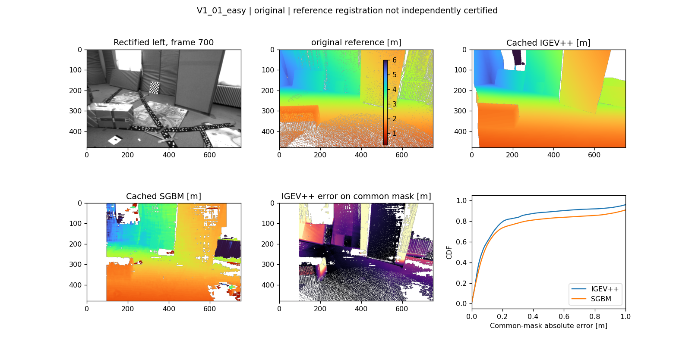
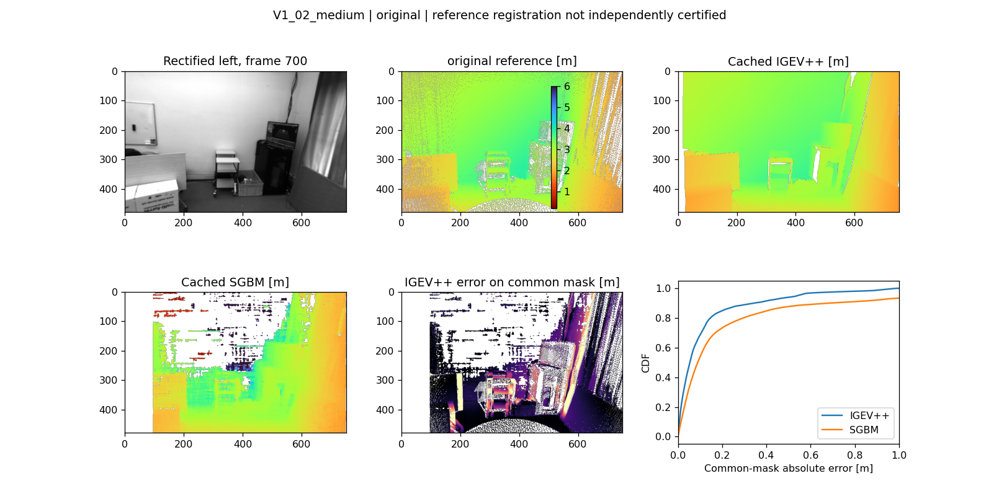
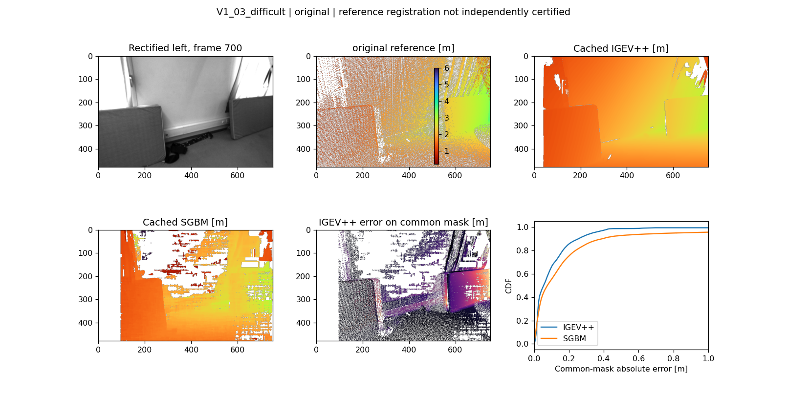

Ngày đánh giá: **2026-11-07 (Asia/Bangkok)**. Phạm vi: snapshot workspace hiện tại.

**VERIFIED** = phép kiểm tra/tính toán được chạy trong đợt audit này, có script và artifact.
**REPORTED** = số được lưu/báo cáo trước đây, chưa chạy lại phép đo tương ứng.
**NOT EVALUATED** = chưa chạy hoặc thiếu điều kiện. Tái tính metric trên prediction lưu sẵn
không đồng nghĩa đã chạy lại inference hay xác thực tuyệt đối ground truth.

Nguồn số liệu audit: [audit_results.json](artifacts/audit_results.json),
[input_manifest.json](artifacts/input_manifest.json), [audit_run.log](artifacts/audit_run.log).
Mã production, estimator, weights và dữ liệu gốc được giữ nguyên; mọi file mới ở `reports/`.

# 02 — Depth, dataset và Leica reference

## Dataset thực có trên đĩa — VERIFIED

| Sequence | cam0 / cam1 | stereo pairs | IMU | GT body | Vicon | Cache depth |
| --- | --- | --- | --- | --- | --- | --- |
| V1_01_easy | 2912 / 2912 | 2912 | 29120 | 28712 | 14629 | 583 |
| V1_02_medium | 1710 / 1711 | 1710 | 17100 | 16702 | 9418 | 342 |
| V1_03_difficult | 2149 / 2149 | 2149 | 21500 | 20932 | 10807 | 430 |

Ảnh 752×480, median ~20 Hz; IMU ~200 Hz, Vicon ~100 Hz, batch body GT ~200 Hz.
Inventory kiểm tra timestamps integer, duplicates/reversed, image files missing và số ảnh trên đĩa;
chi tiết trong JSON. V1_02 có thừa một timestamp cam1, ghép intersection là đúng và cần ghi nhận.
Ba PLY có cùng SHA256 `8836e1dffcdac96d149554865cd9e8df72137c55deeef46bea7f585d79e4291e`,
mỗi file 3.199.068 points: cùng scan phòng Vicon Room 1, không phải ba scan độc lập.
Đường tải local không được ghi trong download manifest; metadata nói Leica Nova MS50 từ sáu vị trí.
Không thể chứng thực nguyên trạng file với checksum publisher chỉ từ repository.

## Leica–Vicon–Camera: kết luận kiểm tra

`pointcloud0/sensor.yaml:8–15` khai báo T_WR=I, nên pointcloud ở frame world của dataset
theo metadata. `stage4_6.py:79–101` thực sự đọc Leica PLY, dùng pose IMU batch và
T_WCrect từ calibration để project. Có z-buffer (`np.minimum.at`) và 2×2 splat,
không phải gán pose GT thành depth GT. Pixel không có reference là NaN và không được chấm điểm.
Scan chỉ là geometric reference: point sampling/splat có thể đưa surface phía sau vào lỗ
của foreground; thiếu meshed visibility, edge erosion, static-region masking và đánh giá
độ nhạy với splat size. `astype(int)` truncate về zero, ảnh hưởng sát border âm.

Đợt audit tái dựng rectification rotation từ relative extrinsic và chiếu lại scan bằng
NumPy/SciPy, dùng intrinsics rectified lưu trong artifact. Kết quả cả ba sequence:
**0 pixel disagreement về mask, max depth difference = 0** với reference gốc đã lưu.
Không có ICP trong evaluation scripts hiện tại. Điều chưa được kiểm chứng độc lập là độ đúng
của orientation/reference registration vật lý và visibility, không phải việc code có chạy projection.

Pose lookup là nearest neighbor, GT tolerance=20 ms, fusion tolerance=30 ms,
không translation interpolation/SLERP. Cần ghi thời gian associate cho mỗi sample;
mật độ nominal 200 Hz không bảo đảm sai lệch <=2.5ms ở mọi gap/end boundary.
Timestamps GT được đọc float64 trong production; độ lượng tử cỡ dưới microsecond là nhỏ
so với nearest-neighbor milliseconds, nhưng nên giữ integer ns.

Tài liệu chính thức cảnh báo orientation **V1_01_easy** và cung cấp reference tính độc lập
từ Vicon/IMU; không xác nhận cùng lỗi cho V1_02/V1_03.
[OpenVINS supported datasets](https://docs.openvins.com/gs-datasets.html).
Code `diag_gt_offset.py` lấy mean(R_VIO⁻¹ R_GT), rồi sửa orientation GT; đây là reference
phụ thuộc phương pháp. Không được dùng nó để tuyên bố sai số tuyệt đối hay chứng minh nguyên nhân.

## Kiểm chứng số liệu đã báo cáo

Coverage disparity frame 700 được tính lại/đối chiếu với artifact; depth range được chuẩn hóa
về [0.2,10] m. SGBM disparity coverage trước clipping khác depth coverage sau clipping.

| Sequence | IGEV valid disparity | SGBM valid disparity | IGEV valid depth | SGBM valid depth |
| --- | --- | --- | --- | --- |
| V1_01_easy | 90.79% | 73.17% | 90.79% | 72.87% |
| V1_02_medium | 95.91% | 69.42% | 95.91% | 61.18% |
| V1_03_difficult | 91.62% | 62.92% | 91.62% | 62.45% |

V1_01 native-mask MAE **0.223138 m / 0.348345 m** tái lập được, tương ứng 22,3/34,8 cm.
**VERIFIED về phép tính trên cached prediction/reference**, chưa là chứng nhận absolute depth
accuracy vì reference orientation V1_01 có cảnh báo và masks khác nhau. Mỗi sequence chỉ có
**một frame được so depth với Leica trong audit này**, index 700; không phải sequence-wide depth benchmark.

## Protocol công bằng đã chạy

G = finite reference trong [0.2,10] m. V_m = prediction hữu hạn trong cùng range.
Native = G∩V_m. Intersection = G∩V_IGEV∩V_SGBM, giống hệt cho cả hai model.
Coverage = |G∩V_m|/|G|, valid image ratio=|V_m|/(752·480).
MAE=mean|Z−Zref|; RMSE=sqrt(mean((Z−Zref)²)); AbsRel=mean(|Z−Zref|/Zref).
Trên full G, không định nghĩa MAE cho missing prediction: báo số missing và coverage,
không lặng lẽ loại rồi gọi là full-mask score; không impute lỗi zero.

### Reference gốc: intersection mask — VERIFIED có điều kiện

| Sequence | Model | n common pixels | MAE m | RMSE m | AbsRel | Common/G |
| --- | --- | --- | --- | --- | --- | --- |
| V1_01_easy | IGEV++ | 221986 | 0.1867 | 0.3592 | 0.0657 | 71.20% |
| V1_01_easy | SGBM | 221986 | 0.3337 | 0.7461 | 0.1182 | 71.20% |
| V1_02_medium | IGEV++ | 171085 | 0.1203 | 0.2184 | 0.0399 | 56.13% |
| V1_02_medium | SGBM | 171085 | 0.3975 | 1.1172 | 0.1227 | 56.13% |
| V1_03_difficult | IGEV++ | 143222 | 0.1072 | 0.1972 | 0.0462 | 65.43% |
| V1_03_difficult | SGBM | 143222 | 0.1981 | 0.5144 | 0.0934 | 65.43% |

### Native mask và full-G missing counts

| Sequence | Model | n native∩G | MAE m | RMSE m | AbsRel | Coverage/G | Missing trên G |
| --- | --- | --- | --- | --- | --- | --- | --- |
| V1_01_easy | IGEV++ | 283925 | 0.2231 | 0.4455 | 0.0747 | 91.07% | 27854 |
| V1_01_easy | SGBM | 227192 | 0.3483 | 0.7644 | 0.1220 | 72.87% | 84587 |
| V1_02_medium | IGEV++ | 293671 | 0.0914 | 0.1797 | 0.0300 | 96.35% | 11133 |
| V1_02_medium | SGBM | 174640 | 0.3945 | 1.1068 | 0.1219 | 57.30% | 130164 |
| V1_03_difficult | IGEV++ | 206181 | 0.1010 | 0.1839 | 0.0447 | 94.20% | 12706 |
| V1_03_difficult | SGBM | 147399 | 0.2084 | 0.5268 | 0.0970 | 67.34% | 71488 |

IGEV++ có MAE/RMSE/AbsRel thấp hơn SGBM trên common mask của cả ba frame đang xét.
Đây là bằng chứng tốt hơn so native-mask MAE, nhưng không chứng minh generalization trên toàn
sequence/dataset, chưa có repeatability inference, confidence interval theo frame/sequence,
reference độc lập và kiểm tra occlusion. Không bootstrap hàng trăm nghìn pixel tương quan
như các sample độc lập để tạo ý nghĩa thống kê giả.

### Theo khoảng cách, phân phối lỗi

| Sequence | Model | GT depth bin m | n | MAE m | RMSE m |
| --- | --- | --- | --- | --- | --- |
| V1_01_easy | IGEV++ | [0.2,1) | 0 | N/A | N/A |
| V1_01_easy | IGEV++ | [1,2) | 56973 | 0.0536 | 0.0758 |
| V1_01_easy | IGEV++ | [2,3) | 95683 | 0.2048 | 0.3819 |
| V1_01_easy | IGEV++ | [3,4) | 46239 | 0.2460 | 0.4876 |
| V1_01_easy | IGEV++ | [4,6) | 23091 | 0.3216 | 0.3820 |
| V1_01_easy | IGEV++ | [6,10) | 0 | N/A | N/A |
| V1_01_easy | SGBM | [0.2,1) | 0 | N/A | N/A |
| V1_01_easy | SGBM | [1,2) | 56973 | 0.1017 | 0.3583 |
| V1_01_easy | SGBM | [2,3) | 95683 | 0.4079 | 0.8827 |
| V1_01_easy | SGBM | [3,4) | 46239 | 0.4009 | 0.8396 |
| V1_01_easy | SGBM | [4,6) | 23091 | 0.4643 | 0.6276 |
| V1_01_easy | SGBM | [6,10) | 0 | N/A | N/A |
| V1_02_medium | IGEV++ | [0.2,1) | 0 | N/A | N/A |
| V1_02_medium | IGEV++ | [1,2) | 6226 | 0.0431 | 0.0622 |
| V1_02_medium | IGEV++ | [2,3) | 83735 | 0.1006 | 0.1820 |
| V1_02_medium | IGEV++ | [3,4) | 80756 | 0.1439 | 0.2529 |
| V1_02_medium | IGEV++ | [4,6) | 368 | 0.7124 | 0.7295 |
| V1_02_medium | IGEV++ | [6,10) | 0 | N/A | N/A |
| V1_02_medium | SGBM | [0.2,1) | 0 | N/A | N/A |
| V1_02_medium | SGBM | [1,2) | 6226 | 0.0766 | 0.1150 |
| V1_02_medium | SGBM | [2,3) | 83735 | 0.1329 | 0.3268 |
| V1_02_medium | SGBM | [3,4) | 80756 | 0.6950 | 1.5905 |
| V1_02_medium | SGBM | [4,6) | 368 | 0.7468 | 0.7702 |
| V1_02_medium | SGBM | [6,10) | 0 | N/A | N/A |
| V1_03_difficult | IGEV++ | [0.2,1) | 0 | N/A | N/A |
| V1_03_difficult | IGEV++ | [1,2) | 59920 | 0.0510 | 0.1273 |
| V1_03_difficult | IGEV++ | [2,3) | 77711 | 0.1265 | 0.2041 |
| V1_03_difficult | IGEV++ | [3,4) | 5591 | 0.4415 | 0.4929 |
| V1_03_difficult | IGEV++ | [4,6) | 0 | N/A | N/A |
| V1_03_difficult | IGEV++ | [6,10) | 0 | N/A | N/A |
| V1_03_difficult | SGBM | [0.2,1) | 0 | N/A | N/A |
| V1_03_difficult | SGBM | [1,2) | 59920 | 0.1739 | 0.6674 |
| V1_03_difficult | SGBM | [2,3) | 77711 | 0.1930 | 0.3419 |
| V1_03_difficult | SGBM | [3,4) | 5591 | 0.5272 | 0.6157 |
| V1_03_difficult | SGBM | [4,6) | 0 | N/A | N/A |
| V1_03_difficult | SGBM | [6,10) | 0 | N/A | N/A |

JSON có q50/q90/q95/q99 và signed mean cho mọi mask/reference; CDF nằm cùng hình comparison.
Không suy kết quả ở range không có sample. Binned coverage dùng cùng denominator full G,
không phải coverage nội bộ từng bin.

### Reference sửa theo VIO — chỉ diagnostic

| Sequence | n common | IGEV MAE m | SGBM MAE m |
| --- | --- | --- | --- |
| V1_01_easy | 221054 | 0.0677 | 0.2306 |
| V1_02_medium | 173532 | 0.0752 | 0.3643 |
| V1_03_difficult | 140222 | 0.0587 | 0.1510 |

Các hình tương tự cho reference diagnostic ở `figures/*_depth_vio_corrected_DIAGNOSTIC.png`.
Màu depth chung 0.2–6m dùng để xem; scoring range vẫn 0.2–10m.

## Model benchmarks và latency

| Model | Local code/weights | Trạng thái đợt audit |
| --- | --- | --- |
| IGEV++ | Có; SceneFlow 58.525.223 bytes, 737 tensor entries hữu hạn | Cached depth metrics VERIFIED; fresh inference/latency NOT EVALUATED |
| StereoSGBM | Code OpenCV có, cached disparity có | Cached metrics VERIFIED; fresh CPU benchmark riêng bên dưới |
| RT-IGEV | `IGEV-plusplus/pretrained_models/igev_rt/sceneflow.pth`, 16.954.349 bytes, 490 tensor entries hữu hạn | Checkpoint readability VERIFIED; strict model load/inference/accuracy/speed NOT EVALUATED |
| RAFT-Stereo | Không tìm thấy source/checkpoint trong workspace | NOT EVALUATED |
| IGEV-Stereo gốc | Không có source/checkpoint riêng; IGEV++ không được đổi nhãn thành IGEV-Stereo | NOT EVALUATED |

Hashes và tensor checks ở [checkpoints.json](artifacts/checkpoints.json). Chưa có publisher
checksum để xác nhận provenance. Không tải model/dataset, không train hoặc sửa weights.
Windows Python có CUDA PyTorch nhưng thiếu `cv2`, `timm`, `open3d`, `evo` trong môi trường đó;
môi trường NumPy/SciPy/Matplotlib dùng audit riêng. Không ghép binary packages giữa Python 3.11/3.13.
MobileNet extractor gọi timm pretrained=True: strict state_dict hợp lệ vẫn chưa đủ nếu
backbone initialization muốn truy cập mạng/cache. Khi tái lập phải xác nhận cache backbone,
dependency versions và strict loading, giữ network offline để tránh tải ngoài ý muốn.

`stage4_6.py:27–29` có một warmup và synchronization; một timed call bao gồm tensor creation,
H2D, forward và D2H, không chỉ GPU kernel inference. Nó không tính right pass L-R mask,
rectification, I/O và TSDF. `build_report.py:169` nhắc 364ms như lời ghi chú hardcoded,
không có timing log tương ứng. Native JSON hiện tại có timing khác; 364ms và 15ms trong
prompt vẫn **REPORTED** về run đó, không phải latency được audit tái đo.
Cache timing L+R ~0.90–0.93s/pair là REPORTED từ infer_timing JSON, không có warmup tách
riêng/latency distribution đầy đủ, có thể chịu tải hệ thống. Không so 364ms một lượt với
CPU SGBM rồi coi đó là total pipeline speed.

Điều kiện chạy RT-IGEV: môi trường pinned có torch/torchvision/timm/OpenCV phù hợp,
backbone cache offline, loader `core_rt.rt_igev_stereo.IGEVStereo`, hidden_dim=96,
max_disp=192, official default 8 iterations. IGEV++ default hiện tại 16 iterations;
báo rõ từng cấu hình, không gọi là cùng iteration budget. Dùng cùng ảnh rectify,
range, reference/masks; warmup >=5, repeats >=30, CUDA events cho forward và synchronize
cho wall timing; đo riêng preprocess/H2D/forward/D2H/L-R/postprocess/total và peak GPU RAM.
Không có kết quả RT-IGEV giả hay yêu cầu tải checkpoint mới.

## Fresh StereoSGBM CPU benchmark — VERIFIED

Đã chạy trong existing offline Docker image, OpenCV 4.2.0, NumPy 1.17.4,
5 warmups +30 repeats/frame, default OpenCV threads ghi trong JSON.
Không cài dependency mới. Compute time gồm SGBM và chuyển fixed-point disparity sang float;
total gồm remap, compute và depth conversion, chưa gồm disk decode/map initialization/VIO/TSDF.

| Sequence | preprocess mean ms | compute mean ms | compute p90 ms | timed total mean ms | diff cached disparity | max rect image diff |
| --- | --- | --- | --- | --- | --- | --- |
| V1_01_easy | 1.236 | 13.449 | 16.497 | 16.661 | 27.76% | 3 |
| V1_02_medium | 1.195 | 14.466 | 17.996 | 17.373 | 34.43% | 5 |
| V1_03_difficult | 1.240 | 13.819 | 15.726 | 16.685 | 31.90% | 3 |

Đây là benchmark CPU mới riêng. Rectified intensity/disparity khác cached run do
backend/version; differences gồm invalid/valid transitions, không coi max disparity difference
là stereo accuracy. Accuracy comparison chính ở trên dùng cả hai cached predictions với
cùng cached preprocessing. Fresh SGBM không được lặng lẽ thay vào bảng đó hoặc dùng để
khẳng định bitwise reproducibility. [Fresh artifact](artifacts/sgbm_fresh.json).
