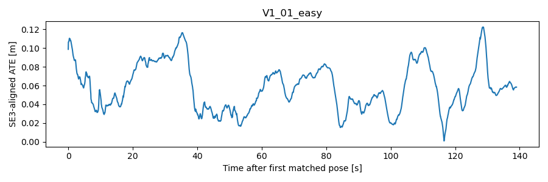
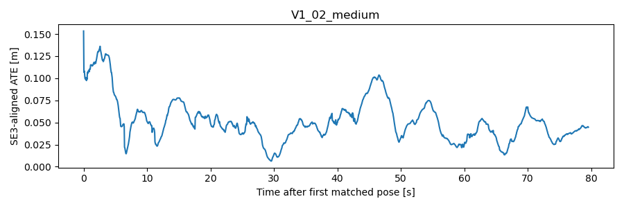
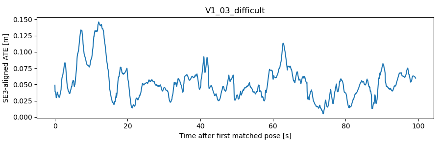

Ngày đánh giá: **2026-11-07 (Asia/Bangkok)**. Phạm vi: snapshot workspace hiện tại.

**VERIFIED** = phép kiểm tra/tính toán được chạy trong đợt audit này, có script và artifact.
**REPORTED** = số được lưu/báo cáo trước đây, chưa chạy lại phép đo tương ứng.
**NOT EVALUATED** = chưa chạy hoặc thiếu điều kiện. Tái tính metric trên prediction lưu sẵn
không đồng nghĩa đã chạy lại inference hay xác thực tuyệt đối ground truth.

Nguồn số liệu audit: [audit_results.json](artifacts/audit_results.json),
[input_manifest.json](artifacts/input_manifest.json), [audit_run.log](artifacts/audit_run.log).
Mã production, estimator, weights và dữ liệu gốc được giữ nguyên; mọi file mới ở `reports/`.

# 03 — OpenVINS evaluation

## Version và actual configuration

Dockerfile yêu cầu v2.7 (`openvins/Dockerfile:9`); đã xác nhận trực tiếp source trong local
image tag v2.7, commit `93adc241390d13e99232652cf05cbe18a93c7bea`.
Image ID `sha256:8fd3b1cab2fbccaec6246bb6086cca16832a88fae4d5c6a35d141ba5bb1f275b`.
Build log cũ nhắc image digest khác, nên không dùng build log để khẳng định image hiện tại
bit-identical với historical run. [Actual configuration snapshot](artifacts/openvins_image.json).

Stereo-inertial, hai camera raw images, KLT, FEJ và RK4 propagation/update của OpenVINS,
không nhận depth IGEV vào estimator. Camera–IMU spatial/time calibration online bật;
mapping không đọc calibration online này. Các giá trị noise trong image khớp YAML dataset:
gyro density 1.6968e-4, walk 1.9393e-5; accel density 2e-3, walk 3e-3 (SI như YAML).
Static initialization window=2s; dynamic init tắt; không có ground-truth initialization
trong launch cục bộ. Không sửa estimator hay calibration trong audit.

## Protocol và kết quả cached trajectories — VERIFIED

Đọc raw GT batch CSV và exported IMU pose; nearest association <=10ms, kiểm tra
one-to-one trên tập này. Fit một SE3 bằng Umeyama/SVD trên position của toàn matched
trajectory, **scale=1**. Quaternion chuyển Hamilton đúng thứ tự, áp dụng cùng world rotation
cho orientation. Không Sim3. Phép tính NumPy/SciPy độc lập không gọi evo hoặc production.

| Sequence | n | Duration s | Path m | ATE RMSE cm | ATE rot ° | max |dt| ms |
| --- | --- | --- | --- | --- | --- | --- |
| V1_01_easy | 2758 | 139.00 | 58.45 | 6.340 | 5.618 | 5.037 |
| V1_02_medium | 1581 | 79.55 | 75.78 | 5.725 | 1.723 | 2.387 |
| V1_03_difficult | 1972 | 99.24 | 78.86 | 5.945 | 2.663 | 2.402 |

Chênh ATE translation với JSON cũ <2e-15 m. Vì vậy **5,7–6,3 cm được tái lập về
measurement trên trajectory đã lưu**. Không có scale fitting để che sai lệch scale.
ATE rotation V1_01 chịu ảnh hưởng cảnh báo GT orientation; translation ATE không cần
orientation GT cho alignment/scoring. Cần corrected reference độc lập để đánh giá orientation.

RPE mới dùng temporal delta=1s, matching endpoint <=30ms, tất cả starting poses hợp lệ;
E = ΔT_GT⁻¹ ΔT_est. Khác definition với RPE spatial 1m/5m của script cũ.

| Sequence | RPE pairs @1s | RPE translation m | RPE rotation ° | Relative endpoint m | first pose delay vs GT s | max pose gap s |
| --- | --- | --- | --- | --- | --- | --- |
| V1_01_easy | 2716 | 0.0444 | 0.4684 | 0.1260 | 4.559 | 0.100 |
| V1_02_medium | 1551 | 0.0347 | 0.2688 | 0.1793 | 3.952 | 0.100 |
| V1_03_difficult | 1939 | 0.0359 | 0.2415 | 0.0377 | 5.410 | 0.150 |

First-pose delay được tính từ timestamp đầu **GT**, không phải đo chính xác thời gian
initialization nội bộ; GT và camera bắt đầu khác nhau. Endpoint metric là relative pose error
giữa hai đầu matched segment, không phải drift chuẩn hóa toàn sequence. Pose gaps 0.10–0.15s
là mất/giảm mẫu output, chưa đủ bằng chứng tracking reset/failure. Số matched không bao trùm
mọi frame camera. Các logs historical V1_01/V1_02 có LibraryUnloadException/exit -6;
không được bỏ qua hoặc quy chắc thành tracking failure khi thiếu log chi tiết thời điểm crash.

### Spatial RPE cũ — REPORTED, chưa chạy lại evo filter-pair protocol

| Sequence | RPE trans @1m m | RPE rot @1m ° | RPE trans @5m m | RPE rot @5m ° |
| --- | --- | --- | --- | --- |
| V1_01_easy | 0.0849 | 1.2603 | 0.2679 | 3.3578 |
| V1_02_medium | 0.0336 | 0.3039 | 0.1000 | 0.5097 |
| V1_03_difficult | 0.0405 | 0.3045 | 0.0918 | 0.7708 |

## Runtime

| Sequence | cached estimator mean ms | cached p90 ms |
| --- | --- | --- |
| V1_01_easy | 15.394 | 22.890 |
| V1_02_medium | 11.710 | 16.222 |
| V1_03_difficult | 12.720 | 18.613 |

Các giá trị này được **VERIFIED bằng tính lại trên timing log**, nhưng clock measurements
vẫn là historical run; không tính rosbag I/O, recording, ROS publication hay toàn pipeline.
CPU utilization và peak RSS historical không có telemetry: NOT EVALUATED.
Không có VINS-Fusion/ORB-SLAM3 source, binaries hoặc trajectories trong workspace để so sánh.

## Covariance thực có và frame của nó

`openvins_traj.txt` có 20 columns: timestamp, position, xyzw, 6 upper-triangle entries
của rotational covariance, 6 của positional covariance. Đã kiểm tra mọi 3×3 block đối xứng
khôi phục được có eigenvalue dương trong các run đã lưu; không đồng nghĩa covariance calibrated.
`openvins_traj_tum.txt` chỉ 8 columns, mất covariance. Cross-cov position–orientation và
cross-time covariance không nằm trong text export.

Publisher v2.7 lấy marginal state `[p_IinG, q_GtoI]`, reorder vào ROS message position rồi
orientation nhưng không tự chuyển error-state thành world Hamilton tangent.
Position perturbation ở global frame; rotational error của JPL q_GtoI gắn với IMU tangent
theo convention OpenVINS. Muốn propagate sang camera/world phải derive Jacobian đúng sign,
left/right perturbation và lever arm, không coi ROS frame_id=global là đủ.
[Publisher source](https://raw.githubusercontent.com/rpng/open_vins/v2.7/ov_msckf/src/ros/ROS1Visualizer.cpp),
[Recorder source](https://raw.githubusercontent.com/rpng/open_vins/v2.7/ov_eval/src/utils/Recorder.h).

Để UATDF đầy đủ: record nguyên PoseWithCovarianceStamped 6×6, state timestamps,
online spatial/time calibration và cross-correlation cần thiết. Covariance thuộc gauge
OpenVINS trước alignment; alignment GT có uncertainty riêng, không được lặng lẽ xem như exact.

## Fresh OpenVINS runs

| Sequence | fresh n | ATE cm | RPE@1s m / ° | estimator mean ms | container wall s | container exit / node abort |
| --- | --- | --- | --- | --- | --- | --- |
| V1_01_easy | 2758 | 6.340 | 0.0444 / 0.4684 | 13.507 | 72.49 | 0 / True |
| V1_02_medium | 1581 | 5.725 | 0.0347 / 0.2688 | 13.054 | 39.13 | 0 / True |
| V1_03_difficult | 1972 | 5.945 | 0.0359 / 0.2415 | 11.766 | 49.68 | 0 / True |

**VERIFIED**: binary đã chạy mới trên ba bags có sẵn, default configuration trong image,
original launch, không dùng GT vào estimator, isolated containers --read-only --network none.
Recording artifacts nằm trong `artifacts/rerun_{sequence}/`; fresh metrics tính từ raw export
bằng cùng SE3/1s RPE evaluator độc lập. Một lần chạy/sequence, chưa phải multi-seed variance study.
Wall time bao gồm ROS startup/recording, không thay thế per-frame latency; chưa đo peak RSS/CPU utilization.
**Container exit 0 không bảo đảm node sạch**: roslaunch có thể trả 0 dù required node abort -6.
Đã đọc cả child-process message và LibraryUnloadException trong log; bảng ghi hai trạng thái riêng.
Trajectories mới trùng ATE/n với artifact cũ không loại bỏ lỗi lifecycle này; chưa có log chi tiết
để chứng minh abort chỉ xảy ra ở shutdown sau frame cuối. Cần sửa/kiểm chứng cleanup ở một task riêng.
Lần wrapper đầu lỗi shell `set -u` trước ROS setup; đã sửa wrapper riêng của audit và giữ
`setup_attempt*.log/json`, không chạm estimator. Historical crashes và fresh exit phải báo riêng.

