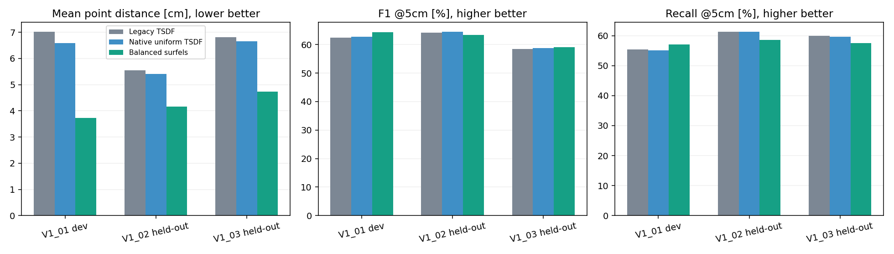
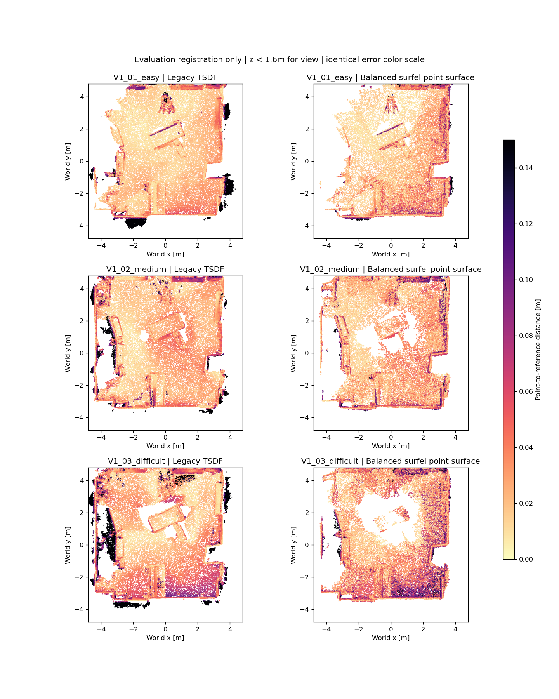

# Fusion v2 — cải thiện kiến trúc depth + VIO

Ngày: **2026-11-08**. Ưu tiên người dùng: **cân bằng chất lượng và tốc độ**.

## Kết quả và cấu hình đã chốt

Đã triển khai và chạy trên ba sequence. Cấu hình cân bằng được chọn **chỉ từ V1_01**,
khóa trước khi chấm V1_02/V1_03: `surfel_uniform`, voxel 3cm, depth 0.2–4m,
tối thiểu **6 keyframe quan sát**, loại connected components dưới **30 points**.
Đầu ra chính là **point surface dạng surfel**, không phải watertight TSDF mesh.
TSDF mesh backend mới vẫn có để dùng khi cần mesh.

Không bật confidence weighting mặc định: các proxy spatial/temporal đã thử làm F1
giảm ở development. Có implementation và numerical tests, nhưng không quảng bá chúng
như improvement hoặc calibrated uncertainty. Kết quả thực quyết định preset.

| Sequence | Method | Mean cm | RMSE cm | P@5cm % | R@5cm % | F1@5cm % | Chamfer cm | Points 2cm |
| --- | --- | --- | --- | --- | --- | --- | --- | --- |
| V1_01_easy | legacy_tsdf | 7.026 | 13.101 | 71.43 | 55.42 | 62.41 | 19.215 | 179202 |
| V1_01_easy | legacy_naive | 4.137 | 6.097 | 72.35 | 62.82 | 67.25 | 16.357 | 656462 |
| V1_01_easy | uniform_support0 | 6.585 | 12.272 | 72.87 | 55.09 | 62.75 | 19.424 | 177365 |
| V1_01_easy | surfel_uniform_support6_cc30 | 3.736 | 4.751 | 73.72 | 57.09 | 64.35 | 22.896 | 320446 |
| V1_02_medium | legacy_tsdf | 5.556 | 8.312 | 67.09 | 61.34 | 64.09 | 9.092 | 221965 |
| V1_02_medium | legacy_naive | 4.834 | 6.583 | 65.12 | 76.45 | 70.33 | 7.360 | 598070 |
| V1_02_medium | uniform_support0 | 5.411 | 8.074 | 68.11 | 61.30 | 64.52 | 9.078 | 223217 |
| V1_02_medium | surfel_uniform_support6_cc30 | 4.161 | 5.168 | 69.04 | 58.54 | 63.36 | 13.550 | 340353 |
| V1_03_difficult | legacy_tsdf | 6.811 | 10.142 | 57.09 | 60.00 | 58.51 | 8.172 | 263744 |
| V1_03_difficult | legacy_naive | 5.610 | 7.790 | 56.64 | 79.96 | 66.31 | 6.459 | 752857 |
| V1_03_difficult | uniform_support0 | 6.663 | 9.939 | 57.97 | 59.68 | 58.81 | 8.198 | 256438 |
| V1_03_difficult | surfel_uniform_support6_cc30 | 4.730 | 5.917 | 60.71 | 57.60 | 59.12 | 13.627 | 395453 |

So sánh dùng cùng Leica reference gốc, fixed ROI, voxel sampling 2cm và thresholds.
GT-derived SE3 registration chỉ được áp dụng **sau khi mapping** để chấm điểm; không ICP,
không `gtrotcorr`, không dùng scan hay GT vào fusion/bounds. Mean/RMSE/Chamfer là
point-to-point trên sampled surface; không gọi là exact mesh point-to-surface accuracy.

Legacy naive accumulation được giữ trong bảng để tránh che baseline mạnh. Một preset
không nhất thiết thắng naive ở mọi precision/recall/F1: phải xem rõ trade-off.
Legacy maps và new maps có thể khác số frame do old aligned trajectory đã cắt theo GT.
**Controlled comparison** là `uniform_support0` với preset mới: cùng raw pose stream,
cùng prepared depths, native bounds, frame timestamps, voxel size và evaluation protocol.
Khác representation/meshing nên các metric điểm vẫn nhạy sampling; chưa chứng minh
quality của continuous surface hoặc mesh topology hơn mọi baseline.



## Kiến trúc thay đổi

1. **Raw VIO native frame:** bỏ GT alignment khỏi input mapping, tính bounds từ observed
   depths; giữ đúng `T_WCrect = T_WI T_ICraw R0ᵀ`.
2. **Linear + SLERP:** pose bracketing, không extrapolate; reject timestamp duplicates/gaps.
3. **Hai mapping backends:** TSDF chỉ quét current frustum AABB; surfel chỉ gom observed
   surface points, không dựng zero crossings trong vùng kém hỗ trợ.
4. **Multi-view support đúng đơn vị:** một voxel nhận tối đa một temporal vote từ một
   input frame, dù nhiều pixel cùng rơi vào đó. Giữ đủ số view trước khi xuất surface.
5. **Conservative cleanup:** loại các cụm nhỏ, không fit ICP hoặc dùng scan để xóa điểm.
6. **Reproducible phases:** prepare/integrate/extract, explicit frames/poses/calibration,
   code/input fingerprints; source/weights/old outputs không bị thay để làm đẹp metric.

Đây là improvement engineering có đo kiểm, chưa phải novel UATDF, và không có fine-tuning.
Online calibration/time offset và covariance cross terms vẫn thiếu từ legacy export;
không coi pose marginal blocks như calibrated relative uncertainty.

## Timing đối chứng cùng dữ liệu

| Same-input backend | Mean ms | Median ms | p90 ms | Peak CUDA MiB |
| --- | --- | --- | --- | --- |
| legacy | 32.889 | 32.725 | 34.232 | 1129.6 |
| frustum_uniform | 14.979 | 15.441 | 18.908 | 392.1 |
| surfel_uniform | 4.856 | 4.710 | 5.477 | 366.9 |

RTX 4060 Laptop GPU; cùng 20 selected development frames/native volume bounds,
5 warmups +30 timed calls, CUDA synchronization; đo H2D + integration, không disk I/O,
stereo inference, confidence preparation hoặc extraction. Peak CUDA là allocated tensor memory,
không toàn process/driver reserved memory. Các backends đo tuần tự trong cùng process.

Depth IGEV++ hiện tại vẫn là runtime bottleneck; không được suy tốc độ end-to-end từ
4–5ms fusion. Chuẩn bị cache offline còn gồm image reads, warps và compression.
Surfel/TSDF volumes hiện dùng dense arrays trong native bounded volume, **không phải**
sparse voxel hashing hoặc unbounded online SLAM. Muốn mapping dài hạn cần submaps.

## Development search và held-out protocol

Chỉ dùng V1_01 để so uniform/spatial/temporal TSDF, surface support, uniform/weighted
surfels và small-component cleanup. Có hai selection drafts được giữ ở
`artifacts/fusion_v2/development_initial/` và `development_quality_only/`.
Sau đó chọn đúng ưu tiên balanced: giữ recall không thấp hơn native uniform quá 2pp,
lấy các candidate có F1 cách best không quá 0.5pp, chọn integration nhanh nhất;
cùng backend thì chọn F1 cao hơn. `selection.json` khóa trước held-out evaluation.
Không chỉnh threshold theo V1_02/V1_03. Chúng vẫn cùng phòng Room1, chưa phải
cross-scene generalization. Nhiều development candidates tạo tuning risk;
cần scene mới cho scientific claim.

| Development candidate | Mean cm | P@5cm % | R@5cm % | F1@5cm % |
| --- | --- | --- | --- | --- |
| legacy_tsdf | 7.026 | 71.43 | 55.42 | 62.41 |
| legacy_naive | 4.137 | 72.35 | 62.82 | 67.25 |
| uniform_support0 | 6.585 | 72.87 | 55.09 | 62.75 |
| uniform_support1 | 6.319 | 74.00 | 54.96 | 63.07 |
| uniform_support2 | 5.619 | 76.19 | 54.73 | 63.70 |
| uniform_support3 | 4.671 | 79.27 | 54.01 | 64.24 |
| uniform_support4 | 4.064 | 81.69 | 53.12 | 64.37 |
| spatial_support0 | 6.907 | 69.32 | 53.93 | 60.67 |
| spatial_support1 | 6.634 | 70.62 | 53.79 | 61.07 |
| spatial_support2 | 5.933 | 72.90 | 53.54 | 61.74 |
| temporal_support0 | 6.982 | 69.11 | 54.02 | 60.64 |
| temporal_support1 | 6.722 | 70.40 | 53.88 | 61.04 |
| temporal_support2 | 5.961 | 72.82 | 53.60 | 61.75 |
| surfel_uniform_support10_cc30 | 3.370 | 78.23 | 51.03 | 61.77 |
| surfel_uniform_support2 | 5.692 | 61.84 | 63.52 | 62.66 |
| surfel_uniform_support3_cc30 | 4.759 | 66.40 | 61.80 | 64.02 |
| surfel_uniform_support3 | 4.780 | 66.34 | 61.90 | 64.05 |
| surfel_uniform_support6_cc30 | 3.736 | 73.72 | 57.09 | 64.35 |
| surfel_temporal_support2 | 5.702 | 61.52 | 63.52 | 62.50 |
| surfel_temporal_support3 | 4.804 | 65.72 | 61.89 | 63.74 |

## Cách chạy preset

```powershell
$cpu = 'C:\Users\Lenovo\Documents\BHYT_Vinmec\.venv\Scripts\python.exe'
$gpu = 'C:\Users\Lenovo\Documents\meddies-health-ai\.venv-4060\Scripts\python.exe'
& $cpu pipeline/run_balanced_fusion.py --sequence V1_02_medium --cpu-python $cpu --gpu-python $gpu --rebuild
```

`--rebuild` là explicit: development cache đã ghi fingerprint phiên bản code lúc prepare,
còn module được bổ sung sau đó. Khi code/settings khác, mapper không silently reuse cache.
Lần chạy mới có thể dùng `--work <new-directory>` để giữ nguyên toàn bộ development outputs.
Không cần cài packages/checkpoint mới trên workstation này; hai existing Python environments
được dùng cho các phase phù hợp. Môi trường đủ dependencies có thể chạy cả ba phase.

Để xuất TSDF mesh: dùng `--variant uniform` cho integrate/extract;
surface support=4 là quality-only development candidate, **không** thay preset balanced.
Không chọn lại threshold bằng cách nhìn held-out metrics. Xem `pipeline/FUSION_V2.md`.

## Files và kiểm tra

- `pipeline/fusion_geometry.py`: camera/coordinate contracts, finite depth và pose interpolation.
- `pipeline/fusion_confidence.py`: visibility-aware causal consistency và confidence proxies (default off).
- `pipeline/fusion_tsdf.py`: FrustumTSDF và VoxelSurfels, one-frame-one-vote.
- `pipeline/fusion_v2.py`: data preparation, GPU integration, extraction/export.
- `pipeline/fusion_balanced.json`, `pipeline/run_balanced_fusion.py`: frozen preset và runner.
- `pipeline/tests/test_fusion_v2.py`: 10 meaningful numerical controls; xem `fusion_v2_tests.log`.
- `reports/artifacts/fusion_v2/`: immutable selection, three evaluation JSONs, timing và summary.
- `outputs/{sequence}/stage8_fusion_v2/`: development/held-out prepared data, volume, PLY và config.
- `outputs/{sequence}/stage8_fusion_balanced/`: fast selected runner, bỏ tính proxy không dùng.

## Giới hạn thực tế

Không thay IGEV++ hoặc OpenVINS estimator; không sửa ROS shutdown exception trong task này.
Không có NLL/reliability calibration, pose/depth cross-covariance propagation hay uncertainty
novelty claim. Camera motion/distortion/online calibration bias vẫn có thể giới hạn map.
Confidence weighting failed development test nên bị loại khỏi default thay vì đổi tên
heuristic thành uncertainty-aware contribution. Original Leica/pose reference caveats
từ audit trước vẫn áp dụng. Chưa chứng minh tối ưu tuyệt đối hoặc đạt 20FPS end-to-end.



## Acceptance gate

**PASS**: mean error below legacy TSDF and F1 no more than 1pp below it on each held-out sequence.
Không thay đổi preset hoặc tiêu chí sau khi xem held-out results.

## Fast path: không tính các confidence proxy đã bị loại


Sau khi chốt quality parameters, chỉ tối ưu performance: runner uniform bỏ spatial/temporal
confidence không dùng, và tính color remap coordinates một lần/sequence. Tham số, depth,
pose và frame set không đổi. Các source đã dùng để khóa selection được giữ nguyên ở
`artifacts/fusion_v2/frozen_sources/`; fast-path code có hashes riêng trong integration logs.
Đã chạy lại **cả ba sequence** bằng runner cuối và đối chiếu với frozen outputs;
`fast_path_validation.json` xác nhận cùng số points, coordinate difference dưới 0.1mm,
pose arrays bằng nhau tuyệt đối và 10 depth/color frames mỗi sequence khớp hoàn toàn.
Baseline source/checkpoint/output hashes được kiểm tra giữ nguyên.
Không chọn lại tham số bằng held-out results.

| Sequence | Frames | Fast prepare mean ms | Fast integrate mean ms | Max coordinate difference m |
| --- | --- | --- | --- | --- |
| V1_01_easy | 560 | 83.62 | 5.49 | 1.4305115e-06 |
| V1_02_medium | 322 | 87.17 | 5.69 | 1.4305115e-06 |
| V1_03_difficult | 401 | 87.88 | 5.54 | 1.4305115e-06 |

Prepare timing còn gồm disk I/O và cache serialization; không coi đó là online kernel latency.
