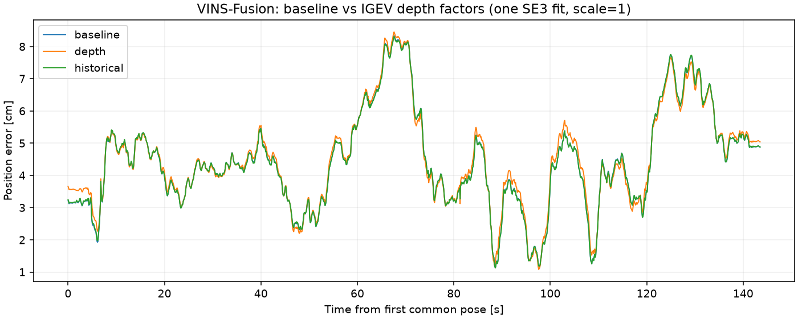

# 09 — IGEV++ depth inside VINS-Fusion

Measured on V1_01_easy, 2026-11-13 (Asia/Bangkok). Integration and benchmark
completed; this report does not assume that depth improves accuracy.

The extension adds optical-depth factors to Ceres pose/landmark optimisation and
the oldest-frame marginalisation prior. Accepted depth replaces the correlated
right-stereo factor at that observation. The original baseline is preserved.
See [implementation and commands](../vins_fusion/DEPTH_INTEGRATION.md).

| Method | ATE RMSE cm | RPE trans 1s cm | RPE rot 1s deg | RPE trans 5s cm | RPE rot 5s deg |
|---|---:|---:|---:|---:|---:|
| Original saved VINS-Fusion | 4.694 | 4.265 | 0.718 | 16.317 | 2.114 |
| Same executable, depth OFF | 4.697 | 4.265 | 0.713 | 16.321 | 2.109 |
| Same executable, IGEV depth ON | 4.744 | 4.267 | 0.686 | 16.350 | 2.079 |

Depth-on ATE changes by **+0.98%** relative to the paired depth-off run
(negative is better). This is one run per mode on one sequence, not a statistical
or cross-dataset claim. The saved historical baseline also shows run variability.

## Protocol and evidence

- 1436 shared GT-matched exposure timestamps over 143.5 seconds.
- One SE3 alignment per method fitted to all common positions, scale fixed at 1.
- RPE uses all available pairs separated by 1s/5s within 1ms, identical across methods.
- Raw EuRoC GT, nearest association <=10ms; no orientation offset fitted or applied.
- Same image, calibration and solver settings; sequential 0.5x replay and 15s drain.
- Both trajectories pass the end-of-input coverage check. Initialisation/missing
  observations are documented in the run metadata.
- Both runs have zero failed residual/Jacobian evaluation windows. Prototype v1
  was rejected for 3 such windows; its diagnostic artifacts are kept separately.
- Depth active in 1418/1429 optimisations;
  mean 161.42, maximum 418 factors per window.
- C++ Jacobian, pose-solve and sampler controls pass; all 16 Python tests pass.
- Every ATE/RPE error was cross-checked with evo: True.

Compact metrics, run metadata, image ID, depth input hashes and code fingerprints:
[vins_depth_v1.json](artifacts/vins_depth_v1.json).
Large trajectories/logs stay under `outputs/V1_01_easy/vins_depth_benchmark_v2/`.

## Limits

Depth comes from the existing IGEV++ cache rather than a fresh inference run.
The export validates L-R masks, range, calibration and neighbourhood consistency;
the historical cache does not establish fresh model-weight provenance.
Only matching cached exposures are used; depth is not propagated between frames.
Sigma is an uncalibrated 5%/2px proxy fixed before scoring, with no GT tuning.
The learned depths are correlated with stereo observations; replacing one factor
does not make all measurements independent. V1_01's documented reference
orientation caveat also affects interpretation of raw-GT RPE. Solver time limits
and asynchronous ROS execution introduce run variability. V1_02/V1_03 have not
been benchmarked with this extension. The baseline stays the default; depth is opt-in.
