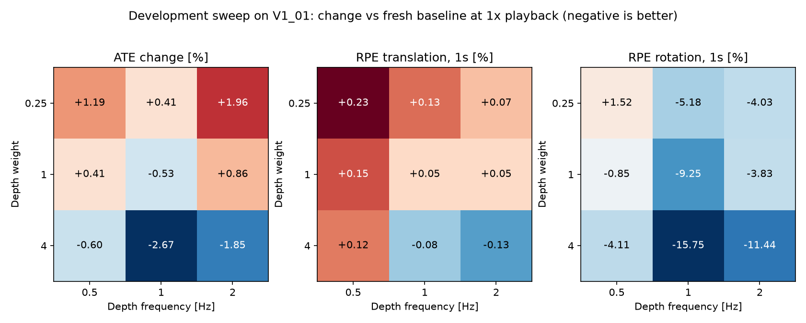

# 10 — Depth weight and frequency sweep

V1_01_easy, 2026-11-13 (Asia/Bangkok). This is development-set tuning using GT.
The selected setting is confirmed by another replay of the same sequence, not
by an independent dataset. Default baseline behaviour is preserved.

## Experiment design

- Nine fixed combinations: nominal Gaussian information multipliers 0.25, 1, 4;
  matching depth-exposure frequencies approximately 0.5, 1, 2 Hz, phase fixed at 0.
- Weight changes sigma by `1/sqrt(weight)`. Huber loss means the complete robust
  objective is not globally scaled by that weight. Measured depth values stay identical.
- Frequency selection respects VINS's existing every-other-image backend phase.
  Backend remains about 10Hz; no stale depth or interpolation between exposures.
- Same depth-v2 executable/image, input bag, calibration, tracking, IMU and solver.
  Sequential full-sequence screening at 1x playback, then confirmation at 0.5x.
- Order shuffled once with seed 42 before scoring; candidate selected by minimum ATE.
- 1436 shared GT timestamps, 143.5s for the screening table.
  SE3 alignment, fixed scale=1, all valid 1s/5s RPE pairs; every error checked with evo.
- Incomplete trajectories, gaps >151ms, solver-evaluation failures and zero depth
  factor activation are rejected; failures are retained in the evidence JSON.

## Screening results (1x playback)

Fresh baseline: ATE 4.7016cm; RPE@1s translation
4.2656cm, rotation 0.7134deg.

| Weight | Depth Hz | ATE cm | ATE change | RPE trans 1s cm | RPE rot 1s deg | RPE trans 5s cm | RPE rot 5s deg |
|---:|---:|---:|---:|---:|---:|---:|---:|
| 0.25 | 0.5 | 4.7573 | +1.186% | 4.2755 | 0.7242 | 16.3843 | 2.0887 |
| 0.25 | 1 | 4.7210 | +0.413% | 4.2711 | 0.6764 | 16.3691 | 2.0762 |
| 0.25 | 2 | 4.7935 | +1.955% | 4.2686 | 0.6846 | 16.3547 | 2.0799 |
| 1 | 0.5 | 4.7210 | +0.412% | 4.2719 | 0.7073 | 16.3691 | 2.0804 |
| 1 | 1 | 4.6767 | -0.530% | 4.2676 | 0.6474 | 16.3514 | 2.0665 |
| 1 | 2 | 4.7421 | +0.862% | 4.2676 | 0.6861 | 16.3514 | 2.0790 |
| 4 | 0.5 | 4.6735 | -0.597% | 4.2708 | 0.6841 | 16.3674 | 2.0745 |
| 4 | 1 | 4.5759 | -2.674% | 4.2620 | 0.6011 | 16.3414 | 2.0505 |
| 4 | 2 | 4.6147 | -1.849% | 4.2602 | 0.6318 | 16.3293 | 2.0612 |

Selected: **weight 4, frequency 1Hz**,
sigma multiplier 0.5. This selection uses V1_01 GT.

## Confirmation results (0.5x playback)

| Pair | Mode | ATE cm | RPE trans 1s cm | RPE rot 1s deg | RPE trans 5s cm | RPE rot 5s deg |
|---:|---|---:|---:|---:|---:|---:|
| 1 | Depth OFF | 4.6982 | 4.2654 | 0.7186 | 16.3215 | 2.1107 |
| 1 | Selected depth ON | 4.5972 | 4.2684 | 0.6806 | 16.3575 | 2.0786 |

Lower ATE confirmed in every pair: **True**.
Lower ATE and non-worse translation/rotation RPE@1s in every pair: **False**.
Non-worse results across all five ATE/RPE metrics in every pair: **False**.
These flags describe measured comparisons, not statistical significance.

## Reproduction and limitations

[vins_depth_sweep_v1.json](artifacts/vins_depth_sweep_v1.json) contains all scores,
the predeclared plan, selection, rejected runs, fingerprints and confirmation.
Large logs/trajectories: `outputs/V1_01_easy/vins_depth_sweep_v1/`.
Depth view definitions: `outputs/V1_01_easy/depth_sweep_views_v1/configs.json`.
Use `pipeline/prepare_depth_sweep.py` and `pipeline/sweep_vins_depth.py`.

GT-guided selection can overfit this sequence. More repetitions and a held-out
sequence are required before a general improvement claim. Raw V1_01 reference
orientation retains the caveat documented in report 09. The model uses cached
depth, fixed 5%/2px base sigma proxies, a 0.2–4m range and the same quality gates.
No default estimator settings are automatically changed by this experiment.
