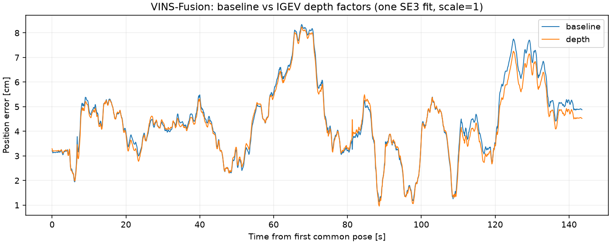
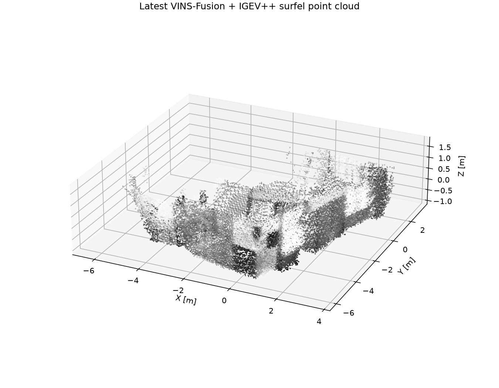

# Latest VINS-Fusion + IGEV++ run

Sequence: V1_01_easy. Depth information weight: 4; depth exposure rate: 1 Hz. Sigma proxies: 1 px and 2.5%; optical Z range: 0.2–4 m. Playback: 0.5x; fixed extrinsic/time offset; loop closure disabled.

The baseline is a frozen earlier depth-OFF run, not a freshly replayed paired control. The settings were selected using GT on this same sequence; this run is not independent validation. RPE translation tradeoffs remain visible. GT is used only for evaluation, never for pose estimation or mapping.

| Metric | Frozen baseline | New depth run | Change |
|---|---:|---:|---:|
| ATE position (cm) | 4.698221 | 4.562572 | -2.887% |
| RPE translation 1s (cm) | 4.265400 | 4.266986 | +0.037% |
| RPE rotation 1s (deg) | 0.718573 | 0.642277 | -10.618% |
| RPE translation 5s (cm) | 16.321468 | 16.335427 | +0.086% |
| RPE rotation 5s (deg) | 2.110672 | 2.066074 | -2.113% |

Matched poses: 1436; independently cross-checked with evo. Native trajectory: 1446 poses; max gap 0.100s. Ceres evaluation failures: 0.

Point cloud: 335,948 surfels; 3 cm voxels, support from at least six distinct frames, components smaller than 30 points removed. Native VIO coordinates; a point surface, not a mesh. No new Leica/reference-cloud mapping score is claimed.

[Run metadata and metrics](artifacts/latest/run.json) · [Native T_WI trajectory](artifacts/latest/trajectory.tum) · [3D point cloud](artifacts/latest/point_cloud.ply)





## Reproduce

Requires Docker Linux containers, a complete NumPy/SciPy/OpenCV/PyYAML/Pillow/PyTorch/evo environment, EuRoC images/calibration, existing IGEV++ disparity inputs, `data/V1_01_easy/input.bag`, and the frozen baseline in `outputs/V1_01_easy/inputs/baseline_reference.tum`. Build the depth image once using `docker build -f vins_fusion/Dockerfile.depth -t depth-vio-vins-igev:depth-v2 .` after building the baseline image as documented in `vins_fusion/README.md`.

```sh
python pipeline/run_tuned_pipeline.py
python reports/scripts/report_latest_run.py
```

Default output: `outputs/V1_01_easy/latest/`. A populated output is refused; select a fresh `--work` when repeating. The preserved disparity and rectification caches are required mapping inputs. Old run directories and generated HTML were removed after validating this result. Reports 01–10 remain historical documentation; their original local run folders may no longer exist.
